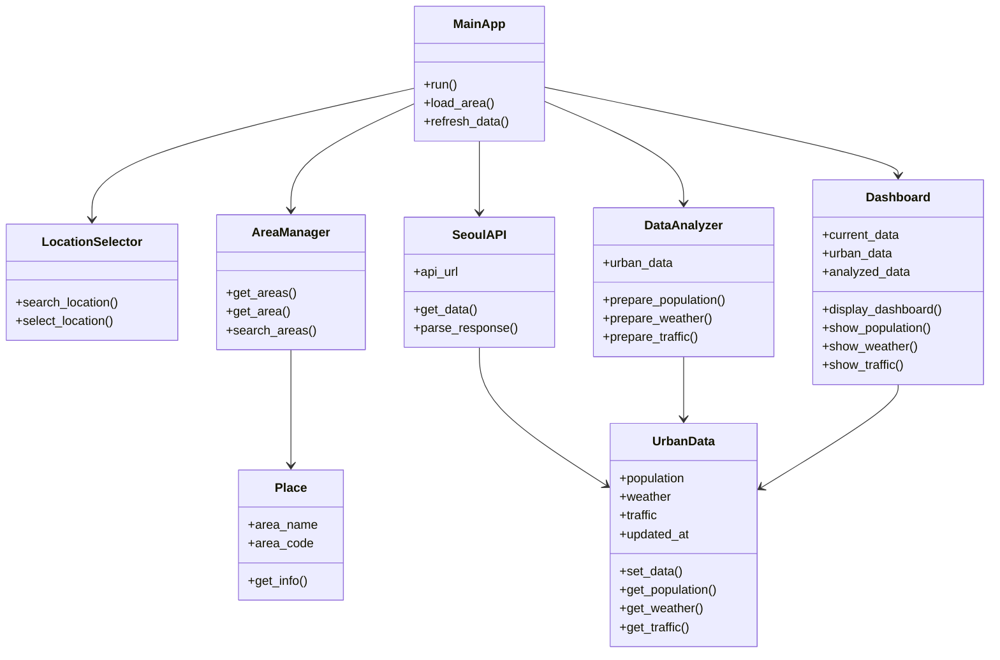

# Seoul Real-Time Urban Data

## 1. 프로젝트 소개

**서울 실시간 도시데이터**는 서울시 실시간 도시데이터 API를 활용하여 사용자가 선택한 서울 지역의 실시간 도시 정보를 확인할 수 있도록 하는 Python 기반 객체지향 프로그래밍(OOP) 팀 프로젝트입니다.

사용자는 서울의 특정 지역을 검색하거나 선택할 수 있으며, 프로그램은 해당 지역의 실시간 인구 및 혼잡도, 날씨, 교통 정보를 수집하고 가공하여 콘솔 화면에 텍스트 형태로 제공합니다.

본 프로젝트는 클래스를 활용하여 데이터 관리, API 연동, 지역 선택, 데이터 처리 및 결과 출력을 분리하는 것을 목표로 합니다.

## 2. 주요 기능

- **지역 검색 및 선택:** 사용자가 원하는 서울 지역을 검색하고 선택합니다.
- **실시간 인구 및 혼잡도 확인:** 선택한 지역의 인구 현황과 혼잡도 정보를 확인합니다.
- **날씨 정보 확인:** 선택한 지역의 날씨 정보를 확인합니다.
- **교통 정보 확인:** 선택한 지역의 교통 상황 정보를 확인합니다.
- **데이터 처리 및 출력:** 수집한 데이터를 가공하여 콘솔 화면에 보기 쉽게 표시합니다.

※ 제공되는 정보는 서울시 실시간 도시데이터 API에서 실제로 제공하는 항목을 기준으로 구현합니다.

## 3. 사용 데이터

- **기본 데이터:** 서울 실시간 도시데이터
- **데이터 수집 방식:** 서울시 실시간 도시데이터 API 연동
- **주요 데이터 항목:**
  - 실시간 인구 및 혼잡도
  - 날씨 정보
  - 교통 정보

## 4. 클래스 설계

| 클래스 | 주요 책임 | 주요 메서드 |
|---|---|---|
| `MainApp` | 전체 프로그램의 흐름을 제어하고 각 클래스를 연결합니다. | `run()`, `load_area()`, `refresh_data()` |
| `LocationSelector` | 사용자에게 지역 검색어를 입력받고 지역을 선택합니다. | `search_location()`, `select_location()` |
| `AreaManager` | 지원 지역 목록을 관리하고 지역을 검색합니다. | `get_areas()`, `get_area()`, `search_areas()` |
| `Place` | 지역명과 지역 코드 등 변하지 않는 기본 정보를 저장합니다. | `get_info()` |
| `SeoulAPI` | 서울시 API에 요청을 보내고 응답 데이터를 처리합니다. | `get_data()`, `parse_response()` |
| `UrbanData` | 실시간 인구, 날씨, 교통 정보와 갱신 시간을 저장합니다. | `set_data()`, `get_population()`, `get_weather()`, `get_traffic()` |
| `DataAnalyzer` | 수집한 데이터를 항목별로 가공합니다. | `prepare_population()`, `prepare_weather()`, `prepare_traffic()` |
| `Dashboard` | 가공된 데이터를 콘솔 화면에 출력합니다. | `display_dashboard()`, `show_population()`, `show_weather()`, `show_traffic()` |

## 5. 프로그램 동작 흐름

1. `LocationSelector`가 사용자에게 지역 검색어를 입력받습니다.
2. `AreaManager`가 검색어에 해당하는 지역을 검색하고 선택된 지역 정보를 반환합니다.
3. `Place`가 지역명과 지역 코드 등 기본 정보를 제공합니다.
4. `SeoulAPI`가 선택된 지역의 실시간 데이터를 API를 통해 요청하고 응답을 처리합니다.
5. `UrbanData`가 수집한 인구, 날씨, 교통 데이터를 저장합니다.
6. `DataAnalyzer`가 각 데이터 항목을 사용자에게 이해하기 쉬운 형태로 가공합니다.
7. `Dashboard`가 가공된 정보를 콘솔 화면에 출력합니다.
8. `MainApp`이 전체 과정을 연결하고 프로그램의 실행 흐름을 관리합니다.

## 6. 클래스 다이어그램



## 7. 프로젝트 구조

```text
Seoul-Real-Time-Urban-Data/
├── docs/
│   └── Seoul_Real_Time_Urban_Data_Proposal.docx
├── images/
├── src/
│   ├── area_manager.py
│   ├── dashboard.py
│   ├── data_analyzer.py
│   ├── location_selector.py
│   ├── main.py
│   ├── place.py
│   ├── seoul_api.py
│   └── urban_data.py
├── .gitignore
├── LICENSE
├── README.md
└── requirements.txt
```

## 8. 실행 방법

### 1) 저장소 복제

```bash
git clone https://github.com/Ginaeyo/Seoul-Real-Time-Urban-Data.git
cd Seoul-Real-Time-Urban-Data
```

### 2) 필요한 라이브러리 설치

```bash
pip install -r requirements.txt
```

### 3) 프로그램 실행

```bash
python src/main.py
```

※ API 사용을 위해 필요한 인증 정보와 설정은 서울시 API 안내에 따라 구성해야 합니다.

## 9. 개발 환경 및 기술

- **Language:** Python
- **Programming Paradigm:** Object-Oriented Programming (OOP)
- **Data Source:** Seoul Real-Time Urban Data API
- **Library:** requests
- **Interface:** Console-based dashboard
- **Version Control:** Git, GitHub

## 10. 팀원 역할

| 팀원 | 담당 클래스 및 역할 |
|---|---|
| 에르덴자야 (`Ginaeyo`) | 프로젝트 관리, 일정 조율, GitHub 관리, 문서 작성 및 최종 검토 |
| 할리오나 (`Liuka0715`) | `SeoulAPI`: API 연동 및 실시간 데이터 수집 |
| 민경환 (`Kimmolang11`) | `Place`, `UrbanData`, `MainApp`: 데이터 구조 설계, 클래스 구현 및 프로그램 흐름 통합 |
| 원미혜 (`Today0505`) | `Dashboard`: 사용자 인터페이스 및 결과 출력 |
| 김효중 (`a01056405156-ctrl`) | `AreaManager`, `LocationSelector`, `DataAnalyzer`: 지역 관리, 지역 선택 및 데이터 분석 |

## 11. 개발 계획

본 프로젝트는 콘솔 기반 프로그램으로 구현할 예정입니다. 개발 과정에서 API 응답 데이터를 확인하고, 데이터 수집 및 처리 기능을 구현한 후 각 클래스의 상호작용과 결과 출력을 테스트합니다.

## 12. License

This project is licensed under the MIT License. See the [LICENSE](LICENSE) file for details.
