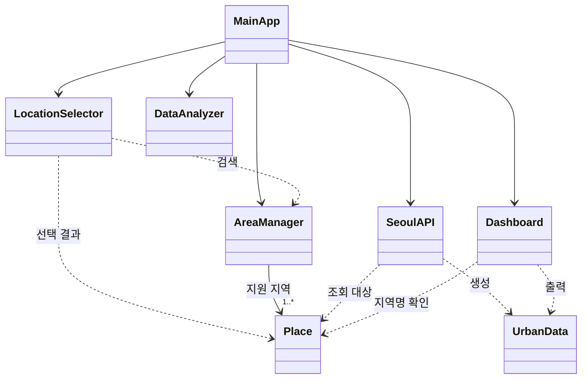

# 서울 실시간 도시데이터

서울시 실시간 도시데이터 API를 사용해 서울의 주요 장소 21곳의 인구혼잡도, 기온, 도로 교통상황을 조회하는 Python 객체지향 프로그래밍(OOP) 팀 프로젝트입니다. 콘솔에서 장소를 검색하고 Matplotlib 그래프로 결과를 확인합니다.

## 주요 기능

| 메뉴 | 기능 |
|---|---|
| 1 | 한 지역의 혼잡도, 기온, 도로 교통상황을 표시합니다. |
| 2 | 두 지역의 혼잡도, 기온, 도로 교통상황을 나란히 표시합니다. 실시간 값과 시연용 값이 섞이면 순위 비교를 생략합니다. |
| 3 | 프로그램을 종료합니다. |

지역 검색에서 Enter를 누르면 지원 지역 전체를 볼 수 있습니다. 콘솔의 인구 수치는 서울시 API가 제공한 추정 범위의 중간값입니다.

## 실행 방법

Windows의 VS Code에서 프로젝트 폴더를 열고, 터미널에서 다음 명령을 실행합니다. 처음 한 번은 가상 환경을 만들고 필요한 라이브러리를 설치합니다.

```powershell
py -m venv .venv
.\.venv\Scripts\python.exe -m pip install -r requirements.txt
.\run.cmd
```

이후에는 프로젝트 폴더에서 `.\run.cmd`만 실행하면 됩니다. 다른 운영체제에서는 프로젝트의 가상 환경에 필요한 라이브러리를 설치한 뒤 `python src/main.py`로 실행할 수 있습니다. 차트 PNG는 `experiments/`에 저장됩니다.

### 실시간 데이터와 시연용 데이터

API 키가 없거나 요청에 실패하면 프로그램은 시연용 데이터를 사용하고 화면에 표시합니다. 실시간 데이터를 조회하려면 [서울시 실시간 도시데이터 API](https://data.seoul.go.kr/dataList/OA-21285/F/1/datasetView.do)에서 발급받은 키를 현재 PowerShell 세션에 설정합니다.

```powershell
$secureApiKey = Read-Host '서울시 API 키를 입력하세요' -AsSecureString
$env:SEOUL_API_KEY = [System.Net.NetworkCredential]::new('', $secureApiKey).Password
.\run.cmd
```

인증키는 현재 터미널 세션에서 사용합니다. 소스 코드나 GitHub에 저장하지 않습니다.

## 클래스 설계

| 클래스 | 역할 | 주요 메서드 또는 필드 |
|---|---|---|
| `MainApp` | 메뉴와 실행 흐름을 관리합니다. | `run()`, `show_area_info()`, `compare_areas()` |
| `LocationSelector` | 검색어와 지역 번호를 입력받습니다. | `select_location()`, `select_comparison_areas()` |
| `AreaManager` | 지원 지역을 관리하고 검색합니다. | `get_areas()`, `get_area()`, `search_areas()` |
| `Place` | 지역명과 선택적인 지역 코드를 저장합니다. | `area_name`, `area_code`, `get_info()` |
| `SeoulAPI` | API 응답에서 필요한 값을 골라 `UrbanData`로 변환합니다. | `get_data()`, `sample_data()` |
| `UrbanData` | 지역명, 혼잡도, 기온, 인구 추정치, 갱신 시각 및 도로 교통상황을 저장합니다. | `area_name`, `congestion`, `weather`, `population`, `updated_at`, `traffic` |
| `DataAnalyzer` | 혼잡도 설명과 비교 결과를 만듭니다. | `analyze_congestion()`, `compare_congestion()` |
| `Dashboard` | 조회 결과를 콘솔에 출력합니다. | `display()`, `show_traffic()` |

`MainApp`은 검색에서 선택한 `Place`를 `SeoulAPI`에 전달합니다. 조회한 `UrbanData`는 콘솔 출력과 그래프에 사용되며, `DataAnalyzer`는 혼잡도 값을 해석합니다. 그래프 함수는 `src/congestion_chart.py`에 있습니다.



## 프로젝트 구조

- `src/` 프로그램과 차트 함수
- `tests/` 단위 테스트와 동작 확인
- `docs/` 팀 설계 및 업무 분담 자료
- `experiments/` 혼잡도 비교 실험과 그래프 저장 위치
- `run.cmd` Windows 실행 명령

## 테스트

```powershell
.\.venv\Scripts\python.exe -m pip install -r requirements-dev.txt
.\.venv\Scripts\python.exe -m pytest -q
```

API 단위 테스트는 가짜 응답으로 실행합니다. 실제 조회를 확인하려면 키를 설정한 후 1번에서 지역을 선택합니다.

## 팀원 역할

| 팀원 | 담당 클래스 및 역할 |
|---|---|
| 에르덴자야 (`Ginaeyo`) | 프로젝트 관리, 일정 조율, GitHub 관리, 문서 작성 및 최종 검토 |
| 할리오나 (`Liuka0715`) | `SeoulAPI`: API 연동 및 실시간 데이터 수집 |
| 민경환 (`Kimmolang11`) | `Place`, `UrbanData`, `MainApp`: 데이터 구조 설계, 클래스 구현 및 프로그램 흐름 통합 |
| 원미혜 (`Today0505`) | `Dashboard`: 사용자 인터페이스 및 결과 출력 |
| 김효중 (`a01056405156-ctrl`) | `AreaManager`, `LocationSelector`, `DataAnalyzer`: 지역 관리, 지역 선택 및 데이터 분석 |

## 향후 개선

지원 지역 추가 확대, 자동 갱신, 웹 화면을 향후 개선 항목으로 검토합니다.

## 팀 개발 안내

저장소 내려받기, 브랜치 만들기, 변경 사항 올리기, 병합 요청 방법은 [팀원용 작업 안내](CONTRIBUTING.md)를 참고하세요.

## 라이선스

이 프로젝트는 MIT 라이선스를 따릅니다. 자세한 내용은 [라이선스 파일](License)을 참고하세요.
