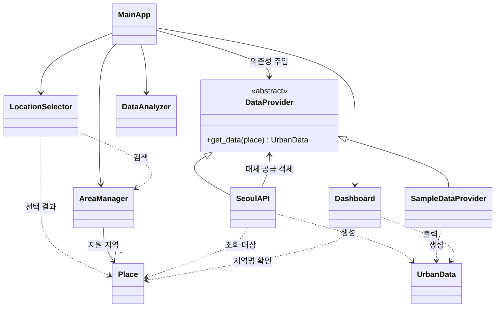

# 서울 실시간 도시데이터

서울시 실시간 도시데이터 API를 사용해 서울의 주요 장소 21곳의 인구혼잡도, 기온, 도로 교통상황을 조회하는 Python 객체지향 프로그래밍(OOP) 팀 프로젝트입니다.

추상화, 상속, 다형성 및 SOLID 원칙을 적용하여 코드의 확장성과 유지보수성을 개선하였습니다.

현재 콘솔에서 장소를 검색하고 Matplotlib 그래프로 결과를 확인할 수 있으며, 향후 웹사이트로 전환할 예정입니다.

## 주요 기능

| 메뉴 | 기능 |
|---|---|
| 1 | 한 지역의 혼잡도, 기온, 도로 교통상황 조회 |
| 2 | 두 지역의 혼잡도, 기온, 도로 교통상황 비교 |
| 3 | 프로그램 종료 |

실시간 값과 시연용 값이 섞이면 혼잡도 순위 비교를 생략합니다.

지역 검색에서 Enter를 누르면 지원 지역 전체를 볼 수 있습니다. 콘솔의 인구 수치는 서울시 API가 제공한 추정 범위의 중간값입니다.

## 실행 방법

Windows의 VS Code에서 프로젝트 폴더를 열고 터미널에서 다음 명령을 실행합니다.

```powershell
py -m venv .venv
.\.venv\Scripts\python.exe -m pip install -r requirements.txt
.\run.cmd
```

이후에는 프로젝트 폴더에서 `.\run.cmd`만 실행하면 됩니다.

다른 운영체제에서는 가상 환경에 필요한 라이브러리를 설치한 뒤 `python src/main.py`로 실행할 수 있습니다.

차트 PNG는 `experiments/`에 저장됩니다.

### 실시간 데이터와 시연용 데이터

API 키가 없거나 요청에 실패하면 프로그램은 SampleDataProvider를 통해 시연용 데이터를 제공합니다.

실시간 데이터를 조회하려면 [서울시 실시간 도시데이터 API](https://data.seoul.go.kr/dataList/OA-21285/F/1/datasetView.do)에서 발급받은 키를 현재 PowerShell 세션에 설정합니다.

```powershell
$secureApiKey = Read-Host '서울시 API 키를 입력하세요' -AsSecureString
$env:SEOUL_API_KEY = [System.Net.NetworkCredential]::new('', $secureApiKey).Password
.\run.cmd
```

인증키는 환경 변수를 통해 관리하며 소스 코드나 GitHub에 저장하지 않습니다.

## 클래스 설계

| 클래스 | 역할 | 주요 메서드 또는 필드 |
|---|---|---|
| MainApp | 프로그램 실행 흐름 및 의존성 관리 | run(), show_area_info(), compare_areas() |
| DataProvider | 데이터 제공 방식의 공통 규칙을 정의하는 추상 클래스 | get_data() |
| SeoulAPI | 실시간 API 데이터 수집 및 처리 | get_data(), sample_data() |
| SampleDataProvider | 시연용 데이터 생성 및 제공 | get_data() |
| LocationSelector | 지역 검색 및 선택 | select_location(), select_comparison_areas() |
| AreaManager | 지역 목록 관리 및 검색 | get_areas(), get_area(), search_areas() |
| Place | 지역명 및 지역 코드 저장 | area_name, area_code, get_info() |
| UrbanData | 도시 데이터 저장 | congestion, weather, population, traffic 등 |
| DataAnalyzer | 혼잡도 분석 및 비교 | analyze_congestion(), compare_congestion() |
| Dashboard | 콘솔 조회 결과 출력 | display(), show_traffic() |

## 추상 클래스 구현

DataProvider는 데이터 제공에 필요한 공통 메서드인 get_data()를 정의하는 추상 클래스입니다.

SeoulAPI와 SampleDataProvider는 DataProvider를 상속하고 get_data()를 구현합니다.

두 클래스는 동일한 방식으로 UrbanData 객체를 반환하므로 MainApp에서 데이터 제공 객체를 교체할 수 있습니다.

```python
from abc import ABC, abstractmethod
from urban_data import UrbanData
from place import Place


class DataProvider(ABC):

    @abstractmethod
    def get_data(self, place: Place) -> UrbanData:
        pass
```

## UML 클래스 다이어그램



## SOLID 원칙 적용

| 원칙 | 적용 내용 |
|---|---|
| SRP (단일 책임 원칙) | 데이터 저장, 지역 관리, API 조회 및 샘플 데이터 생성 책임을 분리 |
| OCP (개방-폐쇄 원칙) | MainApp 내부 코드 수정 없이 새로운 DataProvider 구현체 추가 가능 |
| LSP (리스코프 치환 원칙) | 두 데이터 제공 객체의 기본적인 치환 가능성을 샘플 모드에서 검증 |
| ISP (인터페이스 분리 원칙) | DataProvider에 필요한 get_data() 메서드만 정의 |
| DIP (의존성 역전 원칙) | MainApp이 구체적인 API 객체 대신 DataProvider 추상화에 의존하도록 개선 |

### 의존성 주입 (Dependency Injection)

수정 전:

```python
self.api = SeoulAPI()
```

수정 후:

```python
def __init__(self, api: DataProvider, *, area_manager, location_selector, analyzer, dashboard):
    self.api = api
    self.area_manager = area_manager
    self.location_selector = location_selector
    self.analyzer = analyzer
    self.dashboard = dashboard
```

실행 시 외부에서 데이터 제공 객체를 전달합니다.

```python
MainApp(
    SeoulAPI(fallback_provider=SampleDataProvider()),
    area_manager=AreaManager(),
    location_selector=LocationSelector(),
    analyzer=DataAnalyzer(),
    dashboard=Dashboard(),
).run()
```

이를 통해 구체적인 API 클래스에 대한 직접적인 의존성을 줄이고 테스트와 기능 확장을 쉽게 할 수 있습니다.

## 프로젝트 구조

```text
Seoul-Real-Time-Urban-Data/
├── src/
│   ├── area_manager.py
│   ├── congestion_chart.py
│   ├── dashboard.py
│   ├── data_analyzer.py
│   ├── data_provider.py
│   ├── location_selector.py
│   ├── main.py
│   ├── place.py
│   ├── sample_data_provider.py
│   ├── seoul_api.py
│   └── urban_data.py
├── tests/
│   ├── test_data_provider.py
│   └── ...
├── docs/
├── experiments/
├── requirements.txt
├── requirements-dev.txt
├── run.cmd
└── README.md
```

## 테스트

```powershell
.\.venv\Scripts\python.exe -m pip install -r requirements-dev.txt
.\.venv\Scripts\python.exe -m pytest -q
```

### 테스트 결과

- 전체 테스트: 36개
- 성공: 36개
- 실패: 0개

추상 클래스 구현 및 SOLID 원칙 적용 과정에서 기존 테스트를 수정하고 다음 4개의 테스트를 추가하였습니다.

- 추상 클래스의 직접적인 객체 생성 제한 확인
- 하위 클래스의 상속 관계 확인
- 샘플 데이터 반환 형식 확인
- 데이터 제공 객체의 치환 가능성 확인

API 단위 테스트는 가짜 응답 또는 샘플 데이터를 활용합니다. 실제 조회를 확인하려면 API 키를 설정한 후 지역을 선택합니다.

## 팀원 역할

| 팀원 | 담당 클래스 및 역할 |
|---|---|
| 에르덴자야 (Ginaeyo) | 프로젝트 관리, 일정 조율, GitHub 관리, 문서 작성, 추상 클래스 구현 및 SOLID 원칙 적용 |
| 할리오나 (Liuka0715) | SeoulAPI: API 연동 및 실시간 데이터 수집 |
| 민경환 (Kimmolang11) | Place, UrbanData, MainApp: 데이터 구조 설계, 클래스 구현 및 프로그램 흐름 통합 |
| 원미혜 (Today0505) | Dashboard: 사용자 인터페이스 및 결과 출력 |
| 김효중 (a01056405156-ctrl) | AreaManager, LocationSelector, DataAnalyzer: 지역 관리, 지역 선택 및 데이터 분석 |

## 향후 개선

- 서울시 API 지원 지역 확대
- 웹사이트 구축 및 디자인
- 기존 콘솔 출력 코드를 웹 환경에 맞게 개선
- 실시간 데이터 자동 갱신
- 웹사이트 통합 테스트
- 최종 UML 및 프로젝트 문서 업데이트

## 팀 개발 안내

저장소 내려받기, 브랜치 만들기, 변경 사항 올리기, 병합 요청 방법은 [팀원용 작업 안내](CONTRIBUTING.md)를 참고하세요.

## 라이선스

이 프로젝트는 MIT 라이선스를 따릅니다. 자세한 내용은 [라이선스 파일](License)을 참고하세요.


### SOLID 추가 리팩터링

- MainApp은 분석과 출력 요청을 연결하고 Dashboard가 결과 및 그래프를 표시합니다.
- DataAnalyzer는 혼잡도 단계(1~4 또는 None)와 비교 상태(first_more, second_more, equal, unknown)를 반환하며, Dashboard가 기존 한국어 안내 문장을 생성합니다. 실제·샘플 데이터 혼합 비교 제한은 유지합니다.
- congestion_levels.py의 공통 혼잡도 기준을 분석 및 그래프에서 공유합니다.
- SeoulAPI에는 fallback_provider를 반드시 주입해야 합니다. 실행 진입점에서는 SampleDataProvider를 전달합니다.

### SeoulAPI 책임 분리 (SRP)
- SeoulAPI는 API 요청, 응답 파싱, 유효성 검증 및 수치형 변환, 대체 데이터 요청을 담당합니다. 사용자 대상 메시지는 출력하지 않습니다.
- UrbanData.weather는 기본 공급자에서 float 또는 None이며, population_min/max는 int 또는 None입니다. 기존 population 필드는 호환용으로 유지하지만 API 공급자는 중간값 문자열을 채우지 않습니다.
- DataAnalyzer.calculate_population_midpoint(data)가 범위 중간값(정수 몫)을 반환합니다. MainApp은 이를 Dashboard에 전달하고, Dashboard와 차트 모듈이 표현합니다.
- 대체 사유는 UrbanData.fallback_reason에 저장하고 Dashboard에서 안내합니다. 샘플 인구수는 기존처럼 미제공입니다.
- 기존 CSV 121개 지역과 클래스 10개를 유지합니다. 외부에서 기존 weather/population 문자열에 의존하는 코드는 새 데이터 계약에 맞춰야 합니다.

### 추가 SOLID 개선 (1~6)
- 출처는 `UrbanData.data_source` (`api`/`sample`)로만 판단합니다. 샘플 혼잡도 값에는 표시용 접미사를 저장하지 않습니다.
- `DataAnalyzer.compare_urban_data`가 출처와 혼잡도 비교를 담당합니다. `calculate_average_temperature`가 동일 출처의 유효한 숫자형 기온 평균을 반환하며, 혼합 출처 또는 누락 값은 None입니다.
- `MainApp`은 모든 협력 객체를 생성자에서 주입받습니다. 구체 객체의 생성은 실행 진입점에서 수행합니다.
- `SeoulAPI`는 대체 공급자를 필수로 주입받으며, `DataProvider.get_data`의 입력은 `Place` 객체입니다. 대체 공급에도 동일한 Place 객체를 전달합니다.
- 차트 함수는 출처 인자를 명시적으로 받고, 평균 기온은 계산된 값을 전달받습니다. 기존 외부 호출 코드는 새 시그니처에 맞춰야 합니다.
- LocationSelector 출력, AreaManager CSV 경로 및 SeoulAPI 내부 메서드 분리는 변경하지 않았습니다.
